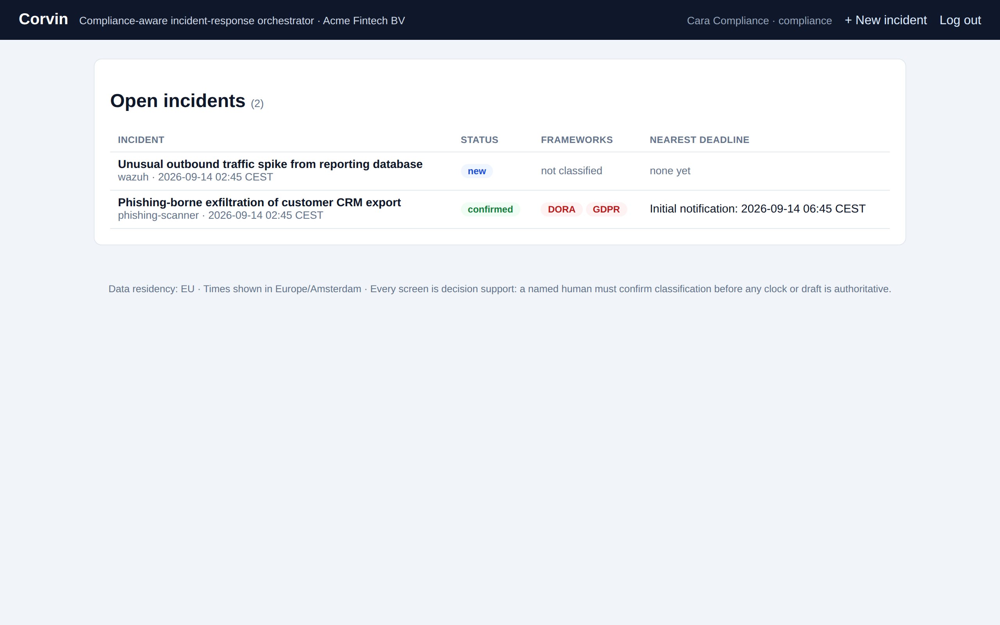
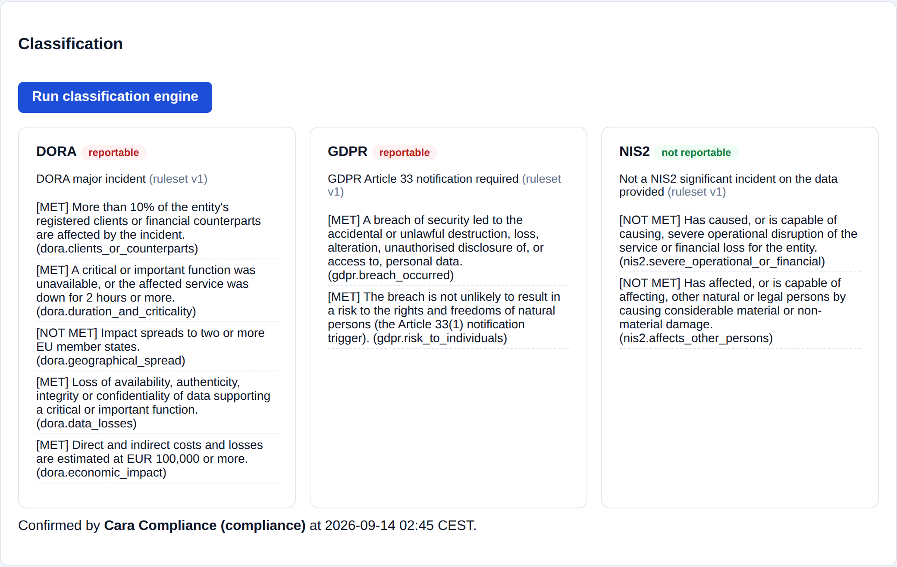
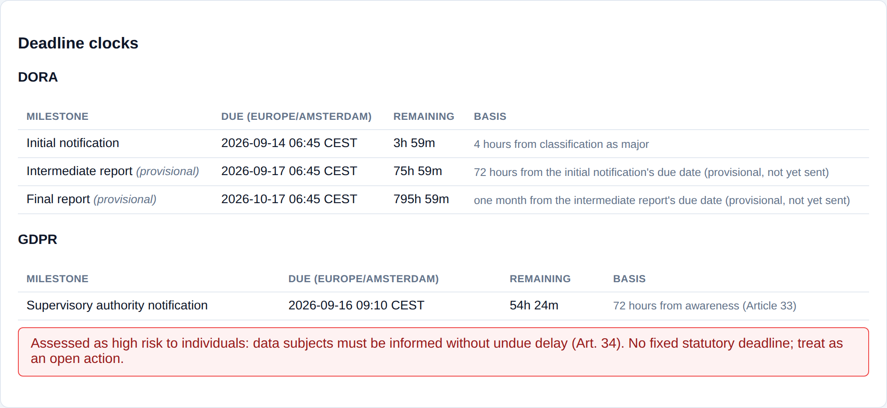
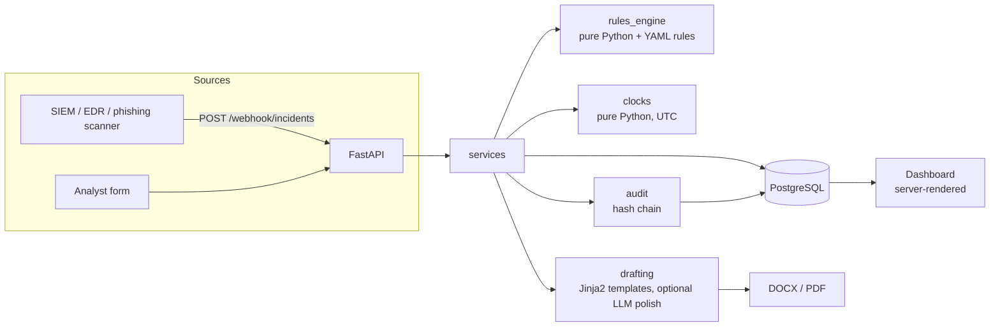

# Corvin

**Compliance-aware incident-response orchestrator for EU financial entities.**
Security incidents flow from detection (SIEM/EDR webhook or manual entry) into
pre-classified, deadline-tracked DORA / NIS2 / GDPR notifications, backed by a
hash-chained audit trail that proves what the team knew and when.

[](https://github.com/el1tino/Corvin/actions/workflows/ci.yml)




---

## The problem

When a fintech is breached, three EU regimes may apply at once, and they
disagree on what counts, who to tell, and when the clock started:

| Framework | Reportable when... | Clocks | Runs from |
|---|---|---|---|
| **DORA** (Reg. 2022/2554) | ICT incident crosses "major" thresholds: clients affected, downtime, geography, data loss, economic impact | Initial **4h** · Intermediate **72h** · Final **1 month** | Classification as major (capped at 24h from awareness), then *each previous report* |
| **NIS2** (Dir. 2022/2555) | Severe operational/financial disruption, or considerable damage to others | Early warning **24h** · Notification **72h** · Final **1 month** | Awareness |
| **GDPR** (Art. 33 and 34) | Personal data breach not unlikely to risk individuals | Supervisory authority **72h** · Data subjects *without undue delay* if high risk | Awareness |

Roughly 62% of ICT incidents at financial institutions involve personal data,
so an incident is routinely reportable under several regimes at the same time.
Existing GRC tools are registers someone types into after the fact. Corvin is
the bridge from the SOC: intake, classification, and deadline math happen
automatically; a **named human** confirms before anything becomes authoritative;
the tool drafts and exports, and a person submits.

## What it does

1. **Intake.** One documented JSON webhook any SIEM/EDR/scanner can post to, plus a manual form.
2. **Classification.** A transparent, versioned, *rules-as-data* engine returns
   `reportable` / `not_reportable` / `needs_human_input` per framework, with
   which rules fired and which facts are still missing, in plain language.
3. **Sign-off.** Nothing downstream is authoritative until a named user confirms
   the classification. Editing facts after a run invalidates it.
4. **Clocks.** Statutory deadlines per framework, computed in UTC from the
   correct start moment for each regime, displayed in the customer's timezone.
5. **Drafts.** Authority-specific notifications filled verbatim from the
   incident's own data; anything unknown is a visible `[PLACEHOLDER]`. Exported
   as DOCX/PDF. Recording a submission anchors the follow-up clocks.
6. **Audit trail.** Every write, run, sign-off, draft, export and submission is
   an append-only, hash-chained event, verifiable offline and enforced
   immutable at the database level.

<p align="center">
  
  
</p>

## Architecture



```
app/
  rules_engine/   classification logic; rules are versioned YAML data, not code
  clocks/         deadline arithmetic per framework (no web/DB deps)
  audit/          hash-chaining + verification (no web/DB deps) and the DB service
  drafting/       templates, deterministic renderer, EU-gated LLM client, exporters
  services/       orchestration: the only layer that mutates state or writes audit events
  api/            JSON routes + the HTML dashboard (both call the same services)
  models/         SQLAlchemy ORM · migrations/  Alembic · tests/  54 tests, 6 realistic fixtures
```

The two packages that carry the domain logic, `rules_engine` and `clocks`,
have no FastAPI, SQLAlchemy, or network dependency and are tested in isolation.
Everything else is a thin layer around them.

## Design decisions worth a look

- **Rules are data.** Thresholds live in [`app/rules_engine/rules/*.yaml`](app/rules_engine/rules)
  with a `version`; each classification run records which version it used and a
  snapshot of the facts it saw, so tuning a rule never rewrites history. The
  engine is three-valued: a missing fact is an *unanswered question*, not a `False`.
- **Three timestamps, not one.** `detected_at`, `awareness_at`, and
  `classification_confirmed_at` are separate columns because the regimes
  disagree on which one starts the clock. All arithmetic is done in UTC, so a
  4-hour window that spans a DST change is still exactly 4 hours, and only
  display is localized ([`app/clocks/utils.py`](app/clocks/utils.py)).
- **DORA's 24h cap.** Initial notification is due 4h after classification *but*
  no later than 24h after awareness; the clock takes the earlier and says so.
  Intermediate/final reports run from the previous report actually being sent,
  so a human "records as submitted" and the provisional projection becomes the
  real deadline.
- **Deterministic-first drafting.** The LLM never decides what the facts are.
  Jinja2 fills every field from the incident and marks gaps as `[PLACEHOLDER]`;
  the model may only polish prose, and its output is rejected if the placeholder
  set changes ([`app/drafting/generator.py`](app/drafting/generator.py)). No API
  key configured? Drafting still works. That is a supported mode, not a fallback.
- **EU data residency is a hard gate.** Incident data is not sent to a non-EU
  LLM region unless `ALLOW_NON_EU_LLM=true` is set explicitly; the refusal is
  logged and recorded in the draft's provenance ([`app/drafting/llm_client.py`](app/drafting/llm_client.py)).
- **Tamper evidence in two layers.** Each audit event hashes the previous one
  (`SHA-256` over a canonical JSON body), and the Postgres migration adds
  `DO INSTEAD NOTHING` rules on `UPDATE`/`DELETE` for the table. The per-incident
  export ships the human timeline *and* the machine-verifiable chain.
- **One service layer, two front doors.** The JSON API and the HTML dashboard
  call identical `services.*` functions, so a webhook and a human click produce
  the same audit events.

## Quick start

```bash
cp .env.example .env          # set JWT_SECRET_KEY / WEBHOOK_TOKEN for anything beyond a demo
docker compose up --build     # Postgres + app; migrations and demo seed run on start
```

Open <http://localhost:8000> and log in with one of the seeded demo accounts:

| Email | Password | Role |
|---|---|---|
| `analyst@corvin.demo` | `CorvinDemo!2026` | analyst: confirms classifications |
| `compliance@corvin.demo` | `CorvinDemo!2026` | compliance: drafts, exports, records submissions |
| `admin@corvin.demo` | `CorvinDemo!2026` | admin: customer config (authorities, timezone) |

With `APP_ENV=production` the app refuses to start on placeholder secrets.

### Ten-minute demo

```bash
CORVIN_URL=http://localhost:8000 CORVIN_WEBHOOK_TOKEN=<your token> \
  python scripts/phishing_scanner_webhook_client.py
```

That sends a confirmed phishing-borne data exfiltration the way an email/threat
scanner would, with `personal_data_involved` already set, so the GDPR path
lights up. Then in the dashboard: run classification, confirm, watch three
clocks appear, generate the DORA initial and GDPR Art. 33 drafts, edit a
placeholder, export PDF, record as submitted, download the audit trail.

## Webhook contract

```
POST /webhook/incidents
X-Webhook-Token: <WEBHOOK_TOKEN>
```
```json
{
  "title": "Phishing-borne data exfiltration",
  "source_system": "wazuh",
  "source_reference": "alert-12345",
  "detected_at": "2026-03-10T08:00:00Z",
  "awareness_at": "2026-03-10T08:15:00Z",
  "facts": {
    "personal_data_involved": true,
    "breach_likely_risk_to_individuals": true,
    "affected_clients_pct": 12,
    "downtime_minutes": 45
  }
}
```

Only `title` and `source_system` are required. Every `facts` field is optional;
what the sender doesn't know comes back as *needs human input* rather than a
guess. The full field list is [`app/schemas/facts.py`](app/schemas/facts.py);
the endpoint is token-authenticated and rate-limited. The OpenAPI spec is at
`/docs` when running.

## Configuration

| Variable | Purpose | Default |
|---|---|---|
| `DATABASE_URL` | SQLAlchemy URL (Postgres in prod, SQLite works for local/tests) | compose-internal Postgres |
| `JWT_SECRET_KEY`, `WEBHOOK_TOKEN` | Session signing / webhook shared secret | placeholders (refused in production) |
| `ANTHROPIC_API_KEY`, `ANTHROPIC_MODEL` | Optional prose polish for drafts | unset (templates only) · `claude-opus-5` |
| `LLM_PROVIDER_REGION`, `ALLOW_NON_EU_LLM` | Data-residency gate | `non-eu`, `false` |
| `DEFAULT_TIMEZONE` | Display timezone (storage is always UTC) | `Europe/Brussels` |
| `APP_ENV` | `production` enables the secret check and secure cookies | `development` |

## Development

```bash
pip install -r requirements-dev.txt
pytest                # 54 tests, ~7s, SQLite in-memory
ruff check . && ruff format --check .
```

| Tests | Cover |
|---|---|
| `test_rules_engine.py`, `test_fixtures.py` | Engine mechanics + six realistic incidents: DORA-only, GDPR-only, NIS2-only, all three, none, needs-human-input |
| `test_clocks.py` | 24h cap, calendar-month arithmetic, DST-spanning windows, backdated awareness, naive-timestamp rejection |
| `test_audit_trail.py`, `test_audit_service_db.py` | Chain verification; edit/delete/reorder detection, including a raw SQL tamper |
| `test_drafting.py`, `test_llm_fallbacks.py` | Placeholder rendering, exporter output, every LLM failure mode degrading safely with a recorded reason |
| `test_services_db.py` | Submitted drafts re-anchoring DORA clocks, sign-off provenance, closing incidents |
| `test_smoke_e2e.py`, `test_dashboard_ui.py` | The full demo walkthrough through the JSON API and through the HTML forms |

Screenshots in `docs/screenshots/` are regenerated with
`python -m scripts.capture_screenshots` (needs `playwright` and a Chromium).

## Scope and honest limitations

- The shipped thresholds are a **starting point** modelled on the DORA
  classification RTS, NIS2 Art. 23 and GDPR Art. 33; each YAML file carries a
  disclaimer and must be reviewed against the primary texts and the customer's
  national transposition before live use. That review is a legal task, not a
  code task, which is exactly why the rules are editable data.
- Single tenant by design. Multi-tenant/MSSP mode, native SIEM connectors,
  the DORA Register of Information (xBRL-CSV), and any direct submission to an
  authority portal are out of scope.
- Form posts rely on `SameSite=Lax` cookies rather than CSRF tokens; the
  webhook rate limiter is in-process. Both are adequate for a single-instance
  MVP and called out in code where they'd need replacing.

## License

MIT. See [LICENSE](LICENSE).
